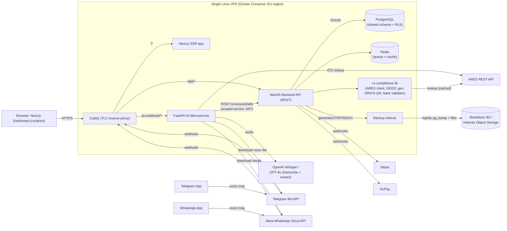

# CZ/SK Invoicing SaaS — Technical Blueprint

## Context

The goal is a modern, multi-tenant SaaS invoicing platform for the Czech/Slovak market that a solo founder can build and operate. Rather than building CZ/SK tax compliance (ARES registry integration, ISDOC e-invoice export, VAT rules) from scratch — which is slow, error-prone, and legally risky to get wrong — the plan leans on an existing MIT-licensed open-source project, **Faktorio**, that has already solved this narrow but hard problem. On top of that compliance foundation, the product adds what turns a compliance tool into a SaaS business: multi-tenancy, subscription billing, a modern dashboard, and a differentiating AI feature (create invoices by sending a voice note over Telegram/WhatsApp). The intended outcome is a concrete, opinionated architecture and a phased roadmap a single developer can execute and deploy securely on one Linux VPS.

Research (via live GitHub/docs lookups, not assumptions) validated and reshaped the original concept in one important way: **Faktorio should not be wrapped as a whole application** — do not run it "headless" as-is. It's a small, single-maintainer, single-tenant project built on tRPC (not REST) and Cloudflare Workers/Turso, with no Docker or multi-tenant precedent. The MIT license, however, means its **compliance logic can be freely extracted and ported** into a purpose-built multi-tenant backend. Invoice Ninja was evaluated and ruled out entirely: it's Elastic License 2.0, which explicitly prohibits offering it as a hosted/managed service to third parties without a commercial deal — a legal blocker for exactly this use case.

The product supports **Czech, Slovak, and English** in the UI and invoice templates from day one (confirmed requirement) — this shapes the frontend i18n and template architecture below.

---

## 1. Open-Source Core: Decision & Extraction Strategy

| | Faktorio | Invoice Ninja |
|---|---|---|
| License | **MIT** (confirmed) | Elastic License 2.0 — forbids hosted/managed-service resale without a commercial license |
| CZ/SK compliance | ARES/VIES lookup, ISDOC 6.0.2 export, Pohoda XML, SPAYD QR, CZ bank validation — already built | None |
| API style | tRPC (couples TS client/server) | Mature REST + webhooks |
| Multi-tenancy | None (single-user/JWT+Google OAuth) | "Multi-company per account," not true SaaS tenant isolation |
| Stack | TS monorepo: React/Vite/Shadcn, Drizzle/Turso, Cloudflare Workers | Laravel/PHP |
| Verdict | **Use as a compliance-logic donor, not as the app** | **Ruled out** — license blocks the business model |

**Extraction plan:** pull Faktorio's compliance modules — ARES/VIES client, ISDOC 6.0.2 XML generator, SPAYD QR generator, CZ/SK bank account (mod-11) validator, VAT rate logic — out of its Cloudflare/tRPC/Turso context and into a standalone internal package, `packages/cz-compliance`, consumed only by the new backend. This keeps ~the entire hard domain-research problem solved while giving full freedom over auth, multi-tenancy, and API shape.

Known gaps to verify during Phase 1 build-out (flagged by research, not yet confirmed):
- Whether ARES's REST response includes VAT-payer (plátce DPH) status directly, or requires a supplementary ADISREG/Financial Administration check.
- ARES has no documented rate limit — must defensively cache + throttle rather than assume unlimited free calls.

---

## 2. Tech Stack

| Layer | Choice | Why |
|---|---|---|
| Frontend | Next.js 14+ (App Router), TypeScript, Tailwind, shadcn/ui | Same UI vocabulary as Faktorio (easy to port screens/components); strong solo-dev ecosystem |
| i18n | next-intl, locales `cs` / `sk` / `en` | App Router-native, type-safe catalogs, locale-prefixed routing |
| Backend API | Node.js + TypeScript + NestJS, plain **REST** (OpenAPI-documented) | Stays in TS so Faktorio's compliance code ports with minimal rewrite; REST (not tRPC) is required because the Python AI microservice and future integrations must call it independently |
| Database/ORM | PostgreSQL + Drizzle ORM | Keeps Drizzle (low rewrite cost) but moves off Turso/libSQL onto Postgres for real Row-Level Security, JSONB, mature backup tooling |
| Compliance lib | `packages/cz-compliance` (ported from Faktorio, MIT) | ARES client, ISDOC generator, SPAYD QR, bank validator — one place owns compliance-critical logic |
| Monorepo | pnpm workspaces + Turborepo | Matches Faktorio's tooling; one CI pipeline for solo maintainability |
| AI microservice | Python + FastAPI | Pydantic gives strict schema validation matching OpenAI structured outputs/function-calling; separate language/service is a hard boundary preventing it from ever touching the DB or compliance lib directly |
| Auth | Auth.js (NextAuth v5), Credentials + Google OAuth, Postgres session store | Avoids Faktorio's Google-only lock-in (many CZ/SK SMBs lack Google Workspace) |
| Billing | Stripe (primary) + GoPay (CZ-local methods) | See §5 |
| Reverse proxy/TLS | Caddy | Auto Let's Encrypt, minimal config vs Traefik/Nginx+Certbot |
| Deployment | Docker Compose, single EU-region VPS (e.g. Hetzner) | One operator, GDPR data residency, workload is CRUD + document generation (not compute-heavy) |
| Queue/cache | Redis + BullMQ (Node side), redis-py (Python side) | Async PDF/ISDOC generation, webhook retries, media processing jobs, ARES cache |
| Object storage | Local volume + Backblaze B2 / Hetzner Object Storage (EU) | Cheap, EU-resident backups and generated documents |
| Secrets | Infisical (or SOPS-encrypted `.env` as lighter fallback) | Centralized rotation once Stripe/GoPay/OpenAI/Telegram/WhatsApp secrets pile up |
| Observability | Sentry + Uptime Kuma + Netdata | Minimal-upkeep stack for one operator |

---

## 3. System Architecture



**Key principle:** the AI microservice never touches Postgres or generates ISDOC itself. It only produces a structured JSON draft and calls the backend's authenticated REST API — architecturally the same client role as the Next.js frontend. All compliance-critical logic (ISDOC correctness, tenant isolation, invoice numbering) lives in exactly one place: the NestJS backend.

---

## 4. Multi-Tenancy: Shared Schema + Row-Level Security

**Decision:** one Postgres database, one schema, every tenant-owned table carries `tenant_id`, enforced by **Postgres RLS** — not database-per-tenant or schema-per-tenant.

Why: at "hundreds of tenants on one VPS," database-per-tenant and schema-per-tenant both multiply migrations, connection pools, and backup/restore operations by tenant count — unmanageable for one person. Shared-schema + RLS gives one migration path, one connection pool, one `pg_dump`, and — critically — a **database-enforced** isolation guarantee: even a missing `WHERE tenant_id = ?` in application code cannot leak cross-tenant data, because Postgres itself rejects the row.

**Representative schema:**
```
tenants (id, company_name, legal_name, ico, dic, dic_vat_payer, address_*,
         bank_account_*, default_locale, subscription_plan_id, subscription_status,
         stripe_customer_id, gopay_payer_id)
users (id, email, password_hash)
tenant_memberships (tenant_id, user_id, role: owner|admin|accountant|viewer)
contacts (tenant_id, ico, dic, legal_name, address_*, ares_verified_at, is_vat_payer)
invoices (tenant_id, contact_id, invoice_number, variable_symbol, issue_date, due_date,
          status: draft|pending_review|issued|paid|cancelled,
          source: manual|ai_telegram|ai_whatsapp|api, ai_confidence_score,
          issued_by_user_id, issued_at, ai_draft_reviewed_at)   -- liability audit trail, see §9
invoice_line_items (tenant_id, invoice_id, description, quantity, unit_price, vat_rate)
invoice_number_sequences (tenant_id, year, last_number)   -- legally required sequential numbering
subscription_plans (id, name, price_czk, price_eur, invoice_limit, features jsonb)
subscription_events (tenant_id, provider, event_type, raw_payload, processed_at)  -- webhook idempotency log
channel_links (tenant_id, channel: telegram|whatsapp, external_user_id, linking_token, is_active)
ares_cache (ico, response_payload, fetched_at)
tos_versions (id, version, published_at, content_hash)
tos_acceptances (user_id, tenant_id, tos_version_id, accepted_at, ip_address)   -- liability evidence trail, see §9
```

**Enforcement pattern:**
1. Every tenant table: `ENABLE ROW LEVEL SECURITY`, policy `USING (tenant_id = current_setting('app.current_tenant_id')::uuid)`.
2. NestJS tenant-context middleware runs `SET LOCAL app.current_tenant_id = '<uuid>'` per request/transaction, after JWT verification.
3. The AI microservice authenticates via the same JWT+RLS path (a scoped token from channel-link resolution, §6) — never a superuser bypass.
4. Runtime DB role is `NOBYPASSRLS`; a separate migration-only role runs Drizzle migrations.
5. **Exception:** `channel_links` carries `tenant_id` but is intentionally NOT RLS-enabled — its job is to resolve `external_user_id → tenant_id` *before* a tenant is known, so a tenant-scoped policy would block the very lookup meant to establish one. It's secured instead by its single-use `linking_token` and the practical unguessability of platform `external_user_id`s (see `apps/backend/drizzle/rls-policies.sql` and `channel-links.service.ts` for the full reasoning).
6. **Narrower variant of the same problem, `tenants` itself:** billing webhooks (§5) must resolve a tenant from a Stripe/GoPay id before any tenant context exists, but `tenants` (unlike `channel_links`) holds real sensitive data, so it keeps `FORCE ROW LEVEL SECURITY` — a blanket exemption isn't acceptable. Instead, two single-purpose `SECURITY DEFINER` Postgres functions (`find_tenant_id_by_stripe_customer_id`, `find_tenant_id_by_gopay_payer_id` in `apps/backend/drizzle/rls-policies.sql`) run with the table owner's privileges but return only a `uuid` for an exact external-id match — RLS on `tenants` stays fully enforced for every other query.

---

## 5. Subscription Billing: Stripe + GoPay

- **Stripe** (primary): Stripe Billing, Checkout for signup, Customer Portal for self-service changes. Webhook (`POST /api/v1/billing/stripe/webhook`) handles `checkout.session.completed`, `customer.subscription.updated/deleted`, `invoice.payment_failed` (mark `past_due`, grace period, dunning email), `invoice.paid`.
- **GoPay** (CZ-local methods/CZK settlement — needed for CZ market fit, but can be a fast-follow after Stripe-only launch): implement as recurring payments via GoPay's pre-authorized recurrence; a scheduled job triggers each cycle's charge; result recorded via GoPay's notification webhook.
- **Idempotency:** every webhook event lands in `subscription_events` keyed by provider event ID (unique constraint) before processing — safe against provider retries.
- **Tenant resolution before RLS context exists:** `TenantBillingRepository`'s `stripe_customer_id`/`gopay_payer_id` → tenant lookups run before `app.current_tenant_id` can be set, so they go through the `SECURITY DEFINER` functions described in §4 point 6, not a normal pooled query.
- **Single source of truth:** `tenants.subscription_status` is written only by webhook handlers, never optimistically by the frontend.
- **Plan gating:** a NestJS guard checks `subscription_status` on invoice-creation/AI-ingestion endpoints; `past_due` → read-only; `canceled` → export-only (also serves GDPR portability).

---

## 6. AI Voice-to-Invoice Microservice

Pipeline (FastAPI service, fully separate from the backend/DB):

1. **Webhook ingress** — Telegram → `/webhook/telegram` (verify secret token header); WhatsApp → `/webhook/whatsapp` (verify Meta's `X-Hub-Signature-256`).
2. **Tenant resolution / account linking** — an unrecognized sender gets onboarding instructions. In the dashboard, a logged-in user generates a short-lived, single-use linking code (or a Telegram deep link `t.me/<bot>?start=<token>`) stored in `channel_links`. Sending that code activates the row, binding `external_user_id → tenant_id`. Every later message resolves tenant via a Redis-cached lookup; unlinked senders are always rejected, never processed.
3. **Media retrieval** — Telegram: `getFile` + download; WhatsApp: resolve media ID via Media endpoint and download immediately (media IDs expire after 7 days — never cached for reuse).
4. **Transcoding** — defensively remux ogg/opus via ffmpeg before Whisper, even though Whisper accepts ogg/opus directly; enforce Whisper's 25MB / Telegram's 50MB limits upstream.
5. **Transcription** — `whisper-1` (~$0.006/min; upgrade path to `gpt-4o-transcribe` if accuracy demands it).
6. **Structured extraction** — GPT-4o function-calling/structured output against a strict schema (counterparty name/IČO, line items, currency, due-date hint); validate with Pydantic, retry once on schema failure.
7. **ARES enrichment** — resolve IČO (or search by name) through `packages/cz-compliance`'s cached ARES client; VAT-payer status is surfaced as "needs verification," never asserted outright (per the confirmed ARES/ADISREG gap).
8. **Draft, never auto-finalize** — `POST /api/v1/invoices/drafts` creates `status = pending_review`, storing raw transcript + extracted JSON + ARES match confidence. No invoice number is allocated yet (CZ/SK law requires immutable sequential numbering only at issue time). Bot replies in-chat with a summary and a deep link to the review screen. **Rationale:** a mis-transcribed amount or mismatched counterparty on a legal tax document is a high-stakes, hard-to-reverse error — human confirmation before issuance is non-negotiable.
9. Human reviews/edits/confirms in the dashboard → "Issue" triggers the normal finalize path (allocates sequence number, generates PDF/ISDOC/SPAYD QR, locks the record).
10. Failed ARES lookups or low-confidence extractions still produce a draft, flagged `needs_attention`, rather than silently failing.

**Rollout order:** Telegram first (Phase 5) — no business-verification wait. WhatsApp (Phase 6) requires Meta Business Cloud API verification, which has real calendar-time lead — start that application in parallel with Phase 5, not after.

---

## 7. i18n

- UI: next-intl, three catalogs `cs`/`sk`/`en`, locale-prefixed routes, default resolved from browser `Accept-Language` then `tenants.default_locale`.
- Invoice PDF templates: rendered server-side (headless-Chromium/Playwright or React-PDF) with their own locale parameter, independent of the tenant's dashboard locale — a CZ business can issue an English invoice to a foreign client without switching their own UI language.
- ISDOC XML is locale-agnostic structured data — no i18n work needed beyond passing through whatever language free-text line items were entered in.

---

## 8. Security & GDPR

- Secrets in Infisical (or SOPS-encrypted `.env`), never plain committed `.env`; separate per environment.
- Tenant isolation enforced at the DB layer (RLS), not just app-layer filtering.
- Caddy auto-TLS on all public endpoints; service-to-service traffic stays on the internal Docker network.
- Nightly logical (`pg_dump`) + WAL point-in-time backups, pushed off-VPS to an EU object store, 30-day retention, **quarterly restore drills**.
- EU-region VPS for data residency; documented DPA template for tenants (you're a data processor for their customers' data); export endpoint doubles as GDPR portability.
- CZ/SK tax law requires ~10-year invoice retention — tenant deletion must anonymize PII but cannot destroy financial records outright; flag for legal review before implementing deletion flows.
- AI microservice holds only a scoped token limited to draft-creation endpoints — never one capable of issuing invoices or reading other tenants' data.

---

## 9. Legal & Liability — Terms of Service (VOP)

**Core principle:** responsibility for the *content and accuracy* of an issued invoice always rests with the entrepreneur (tenant) who issues it — never with the platform. The platform is a tool that helps produce a correctly *formatted* document (ISDOC schema, sequential numbering, VAT arithmetic) and helps *fetch* official registry data (ARES); it does not, and cannot, guarantee that a given invoice is substantively correct for a given tenant's specific tax situation, nor that it remains compliant as CZ/SK tax legislation changes. This must be stated explicitly in the Terms of Service (VOP), not left implicit — and reinforced by product behavior, not just legal text.

**Required VOP clauses** (draft the actual legal wording with a CZ attorney — this lists what must be covered, not final text):
1. **"As-is" disclaimer** — the software is provided "tak, jak je" (as-is), without warranty of fitness for a particular purpose, and without any guarantee that its output complies with current or future tax/accounting legislation.
2. **No tax/legal advice** — the platform is a document-generation and automation tool, not a tax advisor (daňový poradce) or accountant; nothing in the product constitutes tax or legal advice.
3. **User responsibility for content** — the issuing tenant is solely responsible for verifying all invoice data (amounts, VAT rates, counterparty details, due dates) before issuing; if an invoice is later found incorrect, that is a matter between the tenant and the tax authority, not the platform's liability.
4. **AI-output disclaimer** — voice-transcribed and AI-extracted invoice data is explicitly labeled a *draft requiring human review*; the user's act of clicking "Issue" is the legal point at which they assume full responsibility for the content, regardless of how the draft was generated.
5. **ARES/registry data disclaimer** — counterparty data is fetched as-is from the public ARES registry; the platform does not guarantee its accuracy or currency and is not responsible for discrepancies originating in the source registry.
6. **Limitation of liability** — exclude or cap liability for indirect/consequential damages (fines, penalties, tax reassessments) arising from invoice content; keep this consistent with what's actually enforceable under Czech consumer/B2B contract law (a lawyer must confirm the limits — liability for gross negligence or intentional harm typically cannot be excluded).
7. **Governing law & jurisdiction** — Czech law, Czech courts (standard for a CZ-operated SaaS).

**Architectural reinforcement (this is where the legal clause becomes defensible, not just a hoped-for shield):**
- **Versioned ToS acceptance**: `tos_versions` (id, version, published_at, content_hash) and `tos_acceptances` (user_id, tenant_id, tos_version_id, accepted_at, ip_address) tables — every signup and every material VOP update requires a fresh, timestamped, logged acceptance. This is the evidence trail if a liability dispute ever arises.
- **Explicit issuance as a legal act**: the `invoices` table already tracks `status`; add `issued_by_user_id`, `issued_at`, and for AI-sourced drafts, `ai_draft_reviewed_at` — the "Issue" button is the recorded moment the human took responsibility, distinct from whenever the AI produced the draft.
- **In-product disclaimer on AI drafts**: any invoice with `source = ai_telegram|ai_whatsapp` and `status = pending_review` shows a persistent banner in the review screen ("Vytvořeno z hlasové zprávy — zkontrolujte prosím všechny údaje před vystavením") — this is both good UX and supports clause 4 above by making the review step unmissable, not buried in fine print.
- **No silent auto-finalization, ever** — this was already the architectural decision in §6 for risk reasons; it now does double duty as the mechanism that makes clause 4 credible in practice, not just on paper.
- **Signup gate**: ToS acceptance checkbox is a required, non-preselected step in onboarding, tied to the specific `tos_version_id` shown at that moment.

Treat this section as product/architecture requirements derived from a liability strategy — the exact VOP wording still needs a Czech attorney (ideally one with e-commerce/SaaS experience) to draft and periodically review as tax legislation changes.

---

## 10. Phased MVP Roadmap (solo founder, single VPS)

| Phase | Duration | Scope |
|---|---|---|
| 0 — Foundations | 1–2 wks | Monorepo, Docker Compose skeleton (Postgres/Redis/Caddy), Infisical, Sentry/Uptime Kuma, VPS+DNS+TLS smoke test |
| 1 — Compliance extraction | 2–3 wks | Port ARES client, ISDOC generator, SPAYD QR, bank validator from Faktorio into `packages/cz-compliance`; unit tests against known ISDOC/SPAYD fixtures |
| 2 — Backend + multi-tenancy | 3–4 wks | NestJS + Drizzle + Postgres RLS, Auth.js JWTs, tenant middleware, CRUD (tenants/contacts/invoices), ARES auto-fill, invoice numbering, PDF/ISDOC generation endpoint |
| 3 — Frontend dashboard | 3–4 wks | Next.js + shadcn dashboard, auth flows, invoice/contact CRUD UI, next-intl (cs/sk/en) |
| 4 — Billing | 2 wks | Stripe Checkout/Portal/webhooks + plan gating; GoPay as fast-follow before broad CZ marketing push |
| 5 — AI voice (Telegram only) | 3–4 wks | FastAPI service, channel-linking flow + dashboard UI, Whisper + GPT-4o extraction, ARES enrichment, draft creation, review UI |
| 6 — WhatsApp + hardening | 2–3 wks | Meta Cloud API onboarding (start verification in parallel with Phase 5), shared channel abstraction, backup/restore drill, RLS load test, security review |
| 7 — Launch | — | Soft launch to a few design-partner CZ/SK businesses, monitor Sentry/Uptime Kuma, iterate on AI extraction accuracy before wider marketing |

---

## 11. First Files to Create (greenfield — nothing exists yet)

- `packages/cz-compliance/src/ares-client.ts`, `isdoc-generator.ts` — ported from Faktorio
- `apps/backend/drizzle/schema.ts` — shared-schema multi-tenant Postgres schema + RLS policies
- `apps/backend/src/tenancy/tenant-context.middleware.ts` — sets `app.current_tenant_id`
- `apps/backend/src/channel-links/channel-links.controller.ts` — Telegram/WhatsApp linking endpoint
- `apps/ai-service/app/pipeline/voice_to_invoice.py` — transcription → extraction → ARES → draft POST orchestration
- `docker-compose.yml` — Caddy, frontend, backend, AI service, Postgres, Redis, backup sidecar

## Verification Plan

Since this is a greenfield architecture (no code yet), "verification" at this stage means validating the risky assumptions before committing to full build-out:
1. **RLS proof-of-concept**: stand up Postgres, create two tenants' rows in one table, confirm a query without `SET LOCAL app.current_tenant_id` returns zero rows (not an error, not all rows) — validates the core isolation guarantee before any app code is written.
2. **ARES API smoke test**: call `GET /ekonomicke-subjekty/{ico}` for a known real IČO and confirm the response shape, and specifically check whether VAT-payer status is present — resolves the flagged open question from research.
3. **ISDOC round-trip test**: generate an ISDOC file from Faktorio's ported generator and validate it against the official XSD (github.com/isdoc/schema) plus, if possible, import it into a real CZ accounting tool (e.g. Pohoda) to confirm real-world acceptance.
4. **Telegram voice pipeline smoke test**: a throwaway bot, send a real voice note, confirm `getFile` → download → Whisper transcription → GPT-4o structured extraction produces sane output end-to-end before building the full linking/draft UI around it.
5. **Stripe webhook test**: use Stripe CLI to fire test webhook events at the local backend and confirm idempotent handling (send the same event twice, confirm no double-processing).
